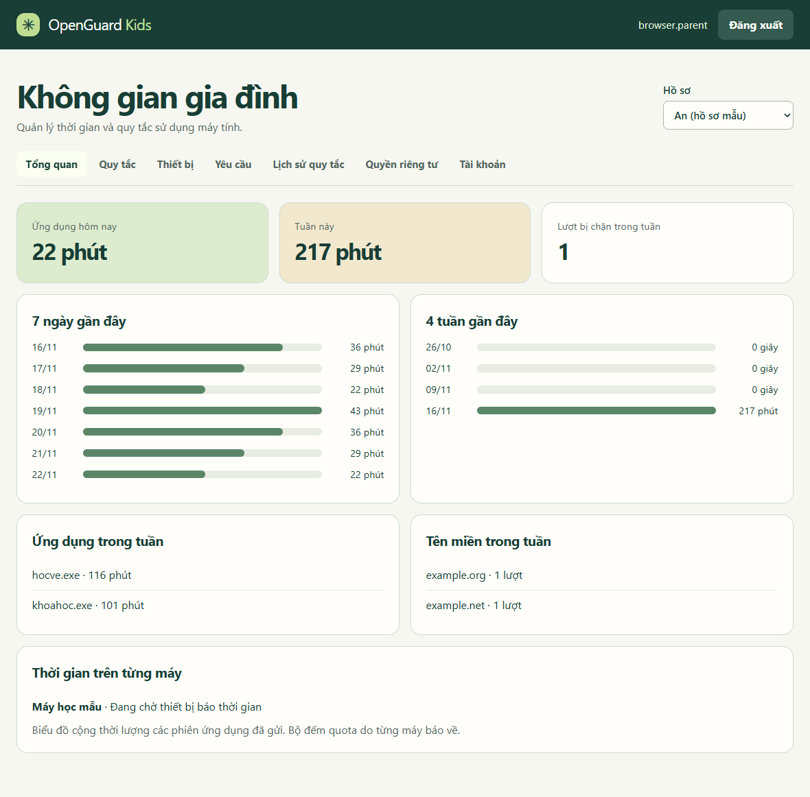

# OpenGuard Kids

Ứng dụng thử nghiệm giúp phụ huynh và trẻ cùng quản lý thời gian sử dụng máy tính. Backend, dashboard tiếng Việt, ghép thiết bị, đồng bộ chính sách và các quyết định mô phỏng chạy trên Windows. Phạm vi nghiệm thu từng chức năng được ghi trong [ma trận yêu cầu](docs/REQUIREMENTS_TRACEABILITY.md).



## Chạy lần đầu trên Windows

Cần Windows 10/11 x64, Python 3.11+ x64 có lệnh `python`, PowerShell và trình duyệt hiện đại. Lần cài đầu cần mạng để lấy các gói từ PyPI. Chạy từ thư mục chứa README bằng tài khoản thường. Mục tiêu cài trong 15 phút cần được đo trên máy sạch.

```powershell
.\scripts\check-env.ps1
.\scripts\setup-dev.ps1
.\scripts\seed-demo.ps1
.\scripts\run-server.ps1
```

Mở **http://127.0.0.1:8000/**. `demo.parent` và `demo.child` dùng hai mật khẩu ngẫu nhiên in một lần ở terminal seed. Dùng một cửa sổ riêng tư cho tài khoản thứ hai. Script seed chỉ chạy trên database trống. Dashboard và API chung một tiến trình. `run-dashboard.ps1` là điểm vào tương đương `run-server.ps1`. `GET /health` trả `{"status":"ok"}` khi migration đúng phiên bản.

`setup-dev.ps1` tạo `.venv`, cài gói và chạy Alembic. Script ghi database vào `.local/dev.sqlite3` và lưu khóa phát triển được DPAPI bảo vệ theo người dùng vào `.local/dev-key.dpapi`. Giữ nguyên khóa khi tái mở database. Các tệp trong `.local` được Git bỏ qua.

## Thử một vòng sử dụng

1. **Phụ huynh** chọn hồ sơ mẫu → **Thiết bị**. Đọc phạm vi, xác nhận quyền giám hộ, việc đã giải thích và sự đồng ý của trẻ trước khi tạo mã. Mã chỉ dùng một lần trong 10 phút.
2. **Máy giả** mở PowerShell thứ hai ở gốc repo. Chạy `.\scripts\run-agent.ps1 -Mode enroll`, nhập mã tại dấu nhắc. Agent lưu danh tính thử bằng DPAPI trong `.local/agent.sqlite3` và tải chính sách. Không sao chép kho này sang tài khoản Windows khác.
3. **Phụ huynh** mở **Quy tắc**, đặt quota 3 phút, chỉnh một ô 30 phút và lưu. Khi khay đã đóng, `.\scripts\run-agent.ps1 -Mode sync` thực hiện một nhịp đồng bộ và báo số lệnh đã xác nhận sau khi áp dụng vào bộ đếm mô phỏng. Khi khay đang chạy, bật phiên mô phỏng và giữ cửa sổ hiển thị để nhận lệnh. Tab **Thiết bị** tự làm mới lịch sử lệnh khi đang mở.
4. **Trẻ** đăng nhập → **Ý kiến của em**, xin thêm 15 phút hoặc gửi miền cần xem lại. **Phụ huynh** mở **Yêu cầu**, chọn thiết bị nhận thời gian và nhập phản hồi. Hai tài khoản đọc cùng dữ liệu báo cáo. Hồ sơ mới và tài khoản child-view được tạo trong **Tài khoản**.
5. **Quyền riêng tư** cho phép xóa riêng hồ sơ giả đã chọn. Chỉ dùng hồ sơ có thể bỏ. Máy ngoại tuyến hiện “Đang chờ thiết bị”. Đồng bộ lại agent để dọn bộ đệm và ACK. Sau khi xóa, cặp tài khoản/máy cũ phải ghép mới cho một hồ sơ khác.

Để thử quota, cảnh báo và DNS ngay cả khi chưa ghép máy, chạy `.\scripts\run-agent.ps1`. Kịch bản này dùng số liệu giả, tăng tốc thời gian và hai socket DNS loopback. Khi học viên chuẩn bị quay demo, giữ nguyên nhãn “mô phỏng” cho các quyết định chưa tác động Windows.

## Chế độ chạy

Để có 10 ngày lịch sử giả cho buổi demo, sau khi ghép thiết bị mang nhãn “Máy mô phỏng” với hồ sơ seed, chạy `.\scripts\seed-demo.ps1 -HistoryForDevice <UUID>` với ID thật của thiết bị thử. Lệnh chỉ thêm sự kiện vào gia đình demo và chống ghi trùng khi chạy lại. ID xuất hiện trong kết quả enrollment hoặc nhật ký ghép máy.

|Chế độ|Lệnh hoặc tài liệu|Phạm vi|
|---|---|---|
|Simulation|`.\scripts\run-agent.ps1`|Đồng hồ, ứng dụng và máy chủ DNS thử; không cần tài khoản hay quyền quản trị.|
|Development|`run-server.ps1`, `run-agent.ps1 -Mode enroll/sync/tray` (chọn một mode)|API, dashboard, cache và tray của phiên người dùng. HTTP phát triển chỉ chấp nhận loopback.|
|Windows Lab|[Hướng dẫn agent](docs/AGENT.md) và [ma trận nghiệm thu](docs/REQUIREMENTS_TRACEABILITY.md)|VM riêng cho cổng 53, DNS adapter, đổi giờ, kiểm chứng tray, ứng dụng thật và SCM; mỗi thao tác hệ thống có xác nhận riêng.|
|Production|Chưa phát hành|Cần nghiệm thu service/IPC, ACL, ngoại lệ khẩn cấp, quy trình vận hành khóa, restore và bảo vệ trẻ ngoài lab.|

### HTTPS và tài khoản vận hành

```powershell
.\scripts\run-server.ps1 -Tls -Port 8443
```

Script sinh chứng chỉ thử cho `localhost` và `127.0.0.1` trong `.local/tls`. Lấy SHA-256 in ở console của server tin cậy. Khi chạy agent trên **cùng máy lab**, thay `<sha256>` bên dưới bằng fingerprint đã đối chiếu. Tạo mã ghép mới trên dashboard của máy chủ này. Ví dụ dùng kho riêng cho địa chỉ HTTPS. Khi đồng bộ hoặc mở tray qua TLS, truyền lại cùng `-Server`, `-Ca`, `-Pin` và `-Store`.

```powershell
.\scripts\run-agent.ps1 -Mode enroll -Server https://127.0.0.1:8443 -Ca .local/tls/ca.pem -Pin '<sha256>' -Store .local/agent-tls.sqlite3
```

HTTP là cách thử dashboard mặc định trên loopback. Ở môi trường lab HTTPS có trình duyệt, người vận hành cần phát chứng chỉ từ CA đã được máy lab tin cậy. Script không tự cài CA. Với triển khai mới, cấp `OGK_SECRET_KEY` (base64 của 32 byte ngẫu nhiên) từ kho bí mật trước khi tạo DB. Tạo tài khoản vận hành trong một PowerShell đã nạp cấu hình bằng các lệnh sau.

```powershell
. .\scripts\common.ps1
Set-DevEnvironment
Invoke-DevPython -m server.cli create-user phuhuynh
```

## Kiểm thử và bằng chứng

```powershell
.\scripts\run-tests.ps1 -q
.\.venv\Scripts\python.exe -m scripts.benchmark_dns --output .local/measurements
```

Pytest dùng DB và danh tính tạm. Các bài FastAPI, WebSocket và DNS cần Windows cho phép socket nội bộ trên loopback. Mở [tiến độ](TASKS.md) để xem kết quả đã chạy và [thư mục bằng chứng](docs/evidence) để xem số liệu thô. Lệnh benchmark không dùng DNS thật của máy. Kiểm thử browser bổ sung chạy bằng `python -m scripts.browser_check` trong `.venv`, với Node.js, Playwright (có thể nạp qua `NODE_PATH`) và MS Edge. Script tự tạo server loopback, dữ liệu thử và đóng phiên khi xong.

## Khắc phục và gỡ môi trường phát triển

- Nếu cổng 8000 đã có chương trình sử dụng, chọn `.\scripts\run-server.ps1 -Port 8010`, mở cổng mới và truyền cùng `-Server http://127.0.0.1:8010` khi ghép máy.
- Nếu PowerShell trên máy riêng chặn script, mở một phiên `powershell -NoProfile -ExecutionPolicy RemoteSigned` theo chính sách phòng máy. Các tệp tải từ Internet cần được kiểm tra nguồn trước khi bỏ dấu nguồn tải.
- Lỗi 403 khi gửi biểu mẫu thường liên quan tới CSRF hoặc sai vai trò. Tải lại trang, kiểm tra tài khoản và hồ sơ. Lỗi 409 lúc lưu lịch nghĩa là đã có phiên bản mới, hãy tải lại trước khi chỉnh tiếp.
- Nếu mất khóa DPAPI hoặc chuyển tài khoản Windows, giữ nguyên DB và bản sao khóa gốc. Muốn thử lại từ đầu, chọn **một database mới** bằng `OGK_DATABASE_URL`; seed từ chối ghi đè dữ liệu đã có.
- Để gỡ bản phát triển, giữ server chạy, thu hồi thiết bị rồi xóa hồ sơ trên dashboard theo luồng xác nhận. Cho các thiết bị kết nối lại, dùng tray hoặc `run-agent.ps1 -Mode sync` với đúng kho và địa chỉ máy chủ để dọn bộ đệm. Kiểm tra biên nhận trên dashboard trước khi đóng tray và nhấn Ctrl+C trong terminal chạy server. Nếu còn thiết bị ngoại tuyến, giữ máy chủ và thông tin ghép để hoàn tất việc xóa khi máy đó trở lại. Sau khi xác định không cần dữ liệu nữa, người vận hành có thể dọn riêng `.local` và `.venv`.
- Với cấu hình mạng lab đã thay đổi thủ công, phục hồi adapter bằng bản ghi cấu hình trước khi gỡ proxy. Các thao tác DNS adapter, SCM, firewall, registry, Group Policy hay khóa phiên thật đều cần quyền và kế hoạch VM riêng.

## Hồ sơ đồ án

Hướng dẫn tra cứu [giao thức ghép máy, xoay pin và đo phục hồi](docs/SYNC.md), [chế độ Windows Lab và IPC](docs/AGENT.md) và [cấu hình, khôi phục DNS trên VM](scripts/lab/README.md).

- [Đề gốc](QuanLyMayTinhTreEm.docx), [kiến trúc và kế hoạch 6 tuần](docs/ARCHITECTURE.md), [API và mô hình dữ liệu](docs/API.md)
- [Ma trận nghiệm thu](docs/REQUIREMENTS_TRACEABILITY.md), [quyền riêng tư](docs/PRIVACY.md), [mô hình đe dọa](docs/THREATMODEL.md), [khai báo AI](docs/AI_USAGE.md)
- [Báo cáo chính](docs/BaoCao.docx), [phụ lục mạng M1–M6](docs/BaoCaoKyThuatMang.pdf), [video demo 5 phút 25 giây](demo/video.mp4), [kịch bản và mốc thời gian](demo/KICH_BAN.md)
