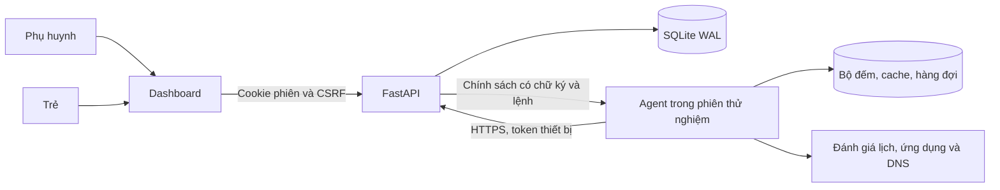

# Kiến trúc và giao thức OpenGuard Kids

Một máy chủ FastAPI phục vụ cả giao diện cùng nguồn và API. SQLite bật WAL, khóa ngoại và giao dịch. Mỗi truy vấn gia đình đi qua kiểm tra chủ sở hữu. Chọn trình duyệt với HTML, CSS và JavaScript cục bộ để phòng máy có thể chạy ngoại tuyến. Không tải font, biểu đồ, analytics hoặc script từ CDN.

**Ranh giới Windows.** Kiến trúc đích có service ở Session 0 và tray ở phiên của trẻ. Service chỉ được thực thi khi nhận được trạng thái hiển thị hợp lệ, đúng tài khoản và còn hiệu lực. Tray mất kết nối, mất sự đồng ý hoặc cache không còn tin cậy phải đưa máy về trạng thái tự do sử dụng. Máy phát triển chỉ dùng tín hiệu mô phỏng. Việc kết thúc tiến trình, đổi DNS, ACL ProgramData, khóa và recovery của SCM cần nghiệm thu trong VM riêng.

**Thời gian.** Lịch dùng giờ Việt Nam, thứ Hai đứng đầu. Mỗi ký tự trong một hàng 48 ô là nửa giờ. Lịch khóa có hiệu lực ngay ở lần đánh giá sau. Với quota, ngưỡng cảnh báo và ân hạn được giải thích trong tài liệu agent. Độ trễ của một lần gọi hàm không đo được độ trễ khóa của hệ điều hành.

**Định danh và đồng ý.** Một tài khoản phụ huynh quản lý nhiều hồ sơ, mỗi hồ sơ có thể có nhiều thiết bị. Dùng biệt danh và định danh cài đặt ngẫu nhiên. Mã ghép dùng một lần, hết hạn sau 10 phút. Lưu phạm vi đồng ý và người xác nhận. Mật khẩu băm scrypt. Khóa phiên và refresh ngẫu nhiên được băm tại máy chủ. Cần giữ khóa mã hóa máy chủ ổn định qua các lần khởi động.

**Đồng bộ.** Agent kiểm tra access token và heartbeat định kỳ 60 giây, so phiên bản rồi tải bản chính sách đã ký. Một request được bọc bằng UUID ngoài bảy trường nghiệp vụ. Ràng buộc duy nhất theo thiết bị và UUID bảo đảm gửi lại lô đã nhận không đếm hai lần. UI và các quy trình tự động phải xác nhận trạng thái thiết bị trước khi báo lệnh đã áp dụng.

**Xóa.** Giao dịch xóa lấy khóa ghi, lưu bằng chứng tối thiểu để thiết bị xác nhận việc xóa, sau đó xóa hồ sơ và tài nguyên liên quan qua khóa ngoại. Thiết bị cũ mất quyền ghi ngay cả khi còn hàng đợi. Dashboard của phụ huynh giữ trạng thái xác nhận riêng cho từng thiết bị, kể cả sau khi hồ sơ biến mất.

## Thành phần đang chạy

|Thành phần|Trách nhiệm hiện tại|Điều kiện vận hành|
|---|---|---|
|FastAPI và SQLite|Xác thực web, ghép máy, ký policy, kiểm quyền từng thiết bị, sự kiện, lệnh/ACK, báo cáo, yêu cầu và xóa|Migration 0007 phân biệt thời điểm cho gỡ với lúc quản trị viên báo đã gỡ service lab.|
|Dashboard|Phụ huynh sửa chính sách, trẻ xem cùng báo cáo và gửi kiến nghị. Bốn liên kết từ khay dẫn thẳng tới trang của trẻ.|Khi trình duyệt đang có phiên người lớn, trang yêu cầu đổi tài khoản trước khi đọc dữ liệu gia đình. Máy dùng chung cần tài khoản Windows hoặc hồ sơ trình duyệt riêng.|
|Tray tương tác|Đồng hồ, engine luật, cache, outbox, heartbeat và thi hành lệnh trên bộ đếm mô phỏng. Trong VM, tùy chọn tính thời gian ứng dụng tiền cảnh cần đúng SID và đồng ý ngay trên khay.|Mất hiển thị thì dừng lấy mẫu. Nghiệm thu bộ lấy mẫu Win32 và đối chiếu sai số cần VM.|
|Service lab|Tiến trình LocalService riêng, giao tiếp trạng thái qua named pipe. Trình cài giới hạn đường dẫn, ACL và thao tác SCM.|Tích hợp engine, kho policy/outbox và xử lý lệnh vào service đích còn dang dở. ACL, recovery và đổi tài khoản cần nghiệm thu trên VM.|

Tray gửi phiên bản đang giữ khi mở WSS. Khi phiên bản thay đổi, máy chủ báo version. Tray tải và kiểm chữ ký qua HTTPS, nạp policy rồi mới áp lệnh đi cùng. Khi kênh lệnh bị ngắt, tray thử kết nối lại với khoảng chờ tăng dần. Heartbeat vẫn chạy lúc giao diện tạm dừng. ACK theo UUID gắn với hiệu ứng đã ghi vào SQLite. Tuổi thọ lệnh là 120 giây.

SPEC-EXTENDED mở rộng bộ đếm và chính sách đã ký, truy vấn báo cáo đã phân quyền và xác thực hiện có. E1–E12 kế thừa các thành phần đó. Từng tính năng có phụ thuộc và phép thử trong [kế hoạch triển khai](IMPLEMENTATION_PLAN.md).

## Kế hoạch cho hai sinh viên

|Tuần|Sinh viên A đề xuất|Sinh viên B đề xuất|Điểm bàn giao|
|---|---|---|---|
|1|Schema, migration, xác thực|Đối chiếu đề, giao diện và mô hình đe dọa|Đăng nhập tại localhost|
|2|Enrollment, token, heartbeat|Cache, tray và IPC theo phiên Windows|Một máy giả ghép được và nhận policy|
|3|DNS proxy và bộ miền an toàn|Bộ đếm thời gian và nhận diện ứng dụng|Đo quota 3 phút, thử đổi tên tệp|
|4|Báo cáo, retention và xóa|Trang trẻ, lịch tuần và xét yêu cầu|Hai vai trò cùng xem một nguồn dữ liệu|
|5|Kiểm thử liên gia đình và mạng lỗi|Lab Windows, thu bằng chứng và hiệu năng|Bộ số đo có mô tả môi trường|
|6|Rà ma trận, viết phụ lục mạng|Cài máy sạch và quay demo|Hai người đối chiếu báo cáo và tự xác nhận đóng góp|

Tên, MSSV, tỷ lệ đóng góp và đánh giá cá nhân do hai sinh viên tự xác nhận sau khi rà soát mã, kết quả thử và lịch sử công việc.
