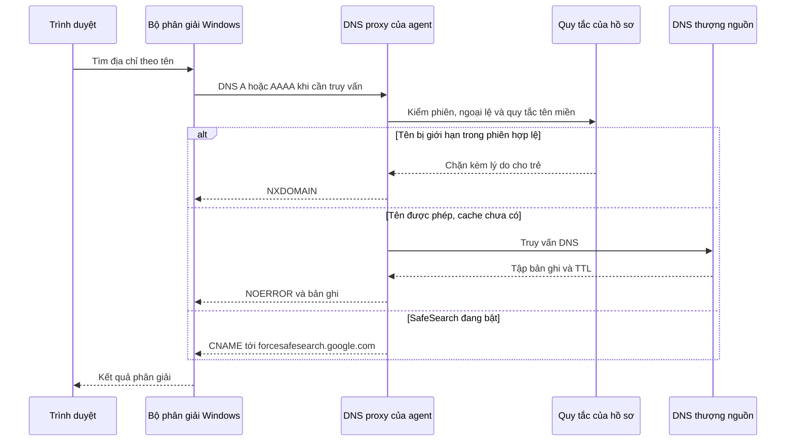
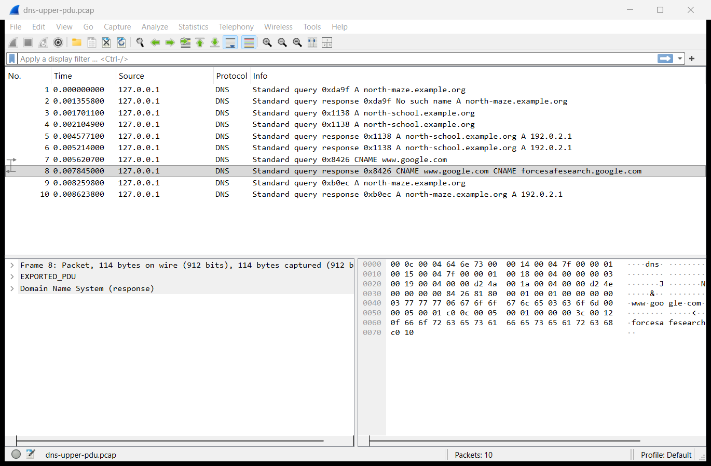

# Phụ lục thực nghiệm mạng M1–M6

Ngày 23/11/2026, OpenGuard Kids trả NXDOMAIN cho cả 50 tên trong bộ thử chặn và trả NOERROR cho cả 40 tên giáo dục. Cả hai kết quả được đo qua UDP loopback với máy chủ phân giải giả. Trên cùng Windows, một tiến trình khay với hồ sơ gia đình giả xử lý gần 50 yêu cầu/giây, dùng 48,41% một lõi CPU ở p95. Các con số mô tả một máy phát triển, Python 3.11.9, Windows build 26200. [Bảng 90 trường hợp](evidence/network-2026-11-23/dns-acceptance.csv) · [Số đo tải cao](evidence/network-2026-11-23/peak/tray-summary.json)

## M1 · Khi trình duyệt yêu cầu một tên miền





Ảnh lấy từ cửa sổ Wireshark 4.6.10 khi mở tệp đã ghi. Socket UDP riêng đóng vai bộ phân giải yêu cầu, dùng IPv4 loopback và cổng tạm. Đồng hồ hiệu năng đơn điệu đánh dấu lúc gửi/nhận và gắn với mốc UTC đầu phép đo. Mỗi bản ghi lưu đúng byte DNS và địa chỉ, cổng thực của socket. Kiểu liên kết 252 *Wireshark Upper PDU* mô tả tầng ứng dụng. Độ dài hiện trong Wireshark bao gồm phần mô tả PDU. CSV có độ dài và SHA-256 riêng cho dữ liệu DNS. Phiên này chưa thử đường từ trình duyệt qua bộ phân giải Windows hoặc ghi tiêu đề IP/UDP trên card mạng. [PCAP](evidence/network-2026-11-23/dns-upper-pdu.pcap) · [Quan sát tại socket](evidence/network-2026-11-23/dns-observations.csv) · [Kết quả TShark](evidence/network-2026-11-23/tshark.txt) · [Định dạng Wireshark](https://www.wireshark.org/docs/wsar_html/exported__pdu__tlvs_8h.html)

| Bản ghi | Vai trò và kết quả |
|---|---|
| 1–2 | Proxy trả NXDOMAIN cho `north-maze.example.org`. Không có truy vấn thượng nguồn tương ứng. |
| 3–6 | Truy vấn `north-school.example.org` đi qua proxy, sang thượng nguồn và quay về với địa chỉ thử nghiệm `192.0.2.1`. |
| 7–8 | Truy vấn CNAME của `www.google.com` nhận `forcesafesearch.google.com.`. Không truy cập Google. |
| 9–10 | Đối chứng cùng tên bị giới hạn, gửi riêng tới máy chủ giả trung tính. Phản hồi chứa `192.0.2.1`. |

SHA-256 của tệp PCAP là `2154469572e7a8bb126102baf277eadef5229049da4b77ac4a19a3c91a934708`. Lệnh `tshark -n -r dns-upper-pdu.pcap` tạo transcript từ cùng tệp. Gói Wireshark x64 4.6.10 được xác thực chữ ký Authenticode của Wireshark Foundation và giải nén để đọc ngoại tuyến. [Các bản phát hành Wireshark](https://www.wireshark.org/download/win64/)

Để xem lại, mở `dns-upper-pdu.pcap` bằng **File → Open** của Wireshark, chọn bản ghi 2 hoặc 8 và mở mục **Domain Name System (response)**. Muốn có ảnh của luồng Windows hoàn chỉnh, dùng VM một người dùng, bộ phân giải riêng và mạng lab riêng. Chỉ ghi trên giao diện dành cho lần thử của VM. Ghi thời gian, truy vấn, phản hồi và khôi phục cấu hình DNS đã sao lưu. [Biên bản nslookup trước đó](evidence/nslookup-safesearch.txt)

## M2 · So sánh các lựa chọn

Các nhận xét về chi phí và hiệu năng trong bảng là đánh giá thiết kế. Chỉ phương án DNS của dự án có số đo ở M4. [Phân giải tên trên Windows](https://learn.microsoft.com/en-us/windows-server/networking/dns/queries-lookups) · [Ngữ nghĩa HTTP CONNECT](https://www.rfc-editor.org/rfc/rfc9110.html#name-connect) · [Kiến trúc WFP](https://learn.microsoft.com/en-us/windows/win32/fwp/windows-filtering-platform-start-page)

| Phương án | Độ chính xác | Phạm vi HTTPS | Chi phí thực hiện | Phạm vi có thể bỏ qua | Ảnh hưởng hiệu năng |
|---|---|---|---|---|---|
| Tệp hosts | Theo từng tên đã khai báo, khó quản lý các tên con | Tác động ở bước phân giải trước TLS | Ít mã, cần sửa tệp hệ thống và khôi phục theo máy | Phụ thuộc ứng dụng dùng bộ phân giải hệ thống | Tra cứu cục bộ, ít việc trên mỗi lần |
| DNS proxy | Theo tên/hậu tố, nhóm và danh sách ngoại lệ. Miền dùng chung vẫn có nhiều loại nội dung | Chặn tên trước TLS, không thấy đường dẫn bên trong HTTPS | Cần UDP/TCP, cache, phục hồi và giới hạn theo phiên | Phụ thuộc truy vấn đi qua proxy | Thêm xử lý mỗi lần DNS. Đã đo ở M4 |
| Proxy HTTP(S) | Thấy đích và đường dẫn HTTP thuần. Với HTTPS CONNECT thông thường, chỉ có đích đường hầm | Có thể từ chối đường hầm tới đích. Đọc đường dẫn HTTPS cần chấm dứt TLS và kéo theo rủi ro riêng tư | Phải quản lý gateway, cấu hình ứng dụng và ngoại lệ | Ứng dụng phải sử dụng proxy | Gánh thêm chuyển tiếp trên đường truyền nội dung |
| Windows Filtering Platform | Phân biệt lưu lượng theo lớp, địa chỉ, cổng hoặc ứng dụng. IP dùng chung khó quy về nội dung | Có thể chặn kết nối mã hóa theo điều kiện mạng | Cần thiết kế bộ lọc, quyền quản trị, rollback và thử tương thích | Phụ thuộc lớp lọc và quyền quản trị thiết bị | Chi phí theo lớp, số quy tắc và cách xử lý mỗi kết nối |

DNS proxy đáp ứng quy tắc theo tên miền và SafeSearch, có thể giải thích quyết định ngay trong phiên và giữ nội dung TLS riêng tư. Quy tắc chỉ có tác dụng khi ứng dụng phân giải qua proxy đang hoạt động.

## M3 · Phạm vi của bộ lọc

Ca đối chứng gửi một truy vấn đến proxy và nhận NXDOMAIN, bộ đếm ghi đúng một truy vấn. Khi dùng các kênh TLS cục bộ trong bảng, từng máy khách xác minh chứng chỉ CA tạm rồi so khớp câu trả lời. Mọi máy chủ chỉ phục vụ tên hoặc nội dung mẫu trên loopback. [Bảy kết quả có đối chứng](evidence/network-2026-11-23/scope.csv) · [Bộ thử cố định](../scripts/check_network_scope.py) · [DoH](https://www.rfc-editor.org/info/rfc8484/) · [DoT](https://www.rfc-editor.org/info/rfc7858/)

| Tình huống | Phép thử và quan sát | Biện pháp hoặc rủi ro được chấp nhận |
|---|---|---|
| Bộ phân giải DNS khác | Cùng tên thử, DNS trung tính trả A, proxy ghi 0 truy vấn. Phần thay đổi adapter Windows còn chờ VM. | Kiểm tra bộ phân giải ở VM một người dùng và lưu bản cấu hình để khôi phục. |
| DNS qua HTTPS | Yêu cầu HTTPS mang dữ liệu DNS tới máy chủ thử trả A, proxy ghi 0 truy vấn. | Thông báo giới hạn khi trình duyệt dùng bộ phân giải riêng. Không giải mã nội dung duyệt. |
| DNS qua TLS | Bản tin DNS trên TLS tới máy chủ thử trả A, proxy ghi 0 truy vấn. | Ghi nhận phạm vi hỗ trợ cho các ứng dụng dùng DNS mã hóa. |
| VPN hoặc proxy | Gateway HTTPS ngược, chỉ phục vụ một tài nguyên giả, chuyển tiếp thành công. Proxy DNS ghi 0 truy vấn. Đường hầm VPN và proxy công cộng chưa thử. | Một kết nối đến gateway có thể che đích cuối đối với bộ lọc tên miền. Chấp nhận rủi ro trong phạm vi sản phẩm này. |
| Địa chỉ IP trực tiếp | Máy khách HTTPS nhận đúng nội dung mẫu từ địa chỉ số có chứng chỉ phù hợp, proxy ghi 0 truy vấn. | Tên miền chỉ là một lớp hỗ trợ. Chặn cả IP dùng chung có thể làm hỏng trang học tập. |
| Tài khoản Windows khác | Cờ định danh phiên trẻ chuyển sang sai trong phép thử. Proxy nhận 1 truy vấn và chuyển tiếp theo chế độ tạm dừng. Đổi SID trên Windows thật còn chờ VM. | Giới hạn theo người dùng, giữ riêng tư cho phiên khác. |
| Kết thúc tiến trình | 30 lần tiến trình agent thử nghiệm thoát sau khi ghi hàng đợi. Tiến trình kế tiếp đồng bộ thành công, chi tiết M5. Chưa thử recovery của SCM. | Duy trì dữ liệu cục bộ và hiển thị trạng thái lần cuối. Có khoảng trống bảo vệ khi worker tắt. |
| Safe Mode | Chưa khởi động Windows vào Safe Mode. Cần VM để xác nhận trạng thái service và khay sau khởi động. | Coi đây là môi trường chưa được bảo vệ. Không can thiệp công cụ phục hồi của Windows. |
| Khởi động từ USB | Chưa khởi động ảnh hệ điều hành thay thế trên VM có firmware phù hợp. | Phần mềm trong Windows không quản lý hệ điều hành khác. Việc kiểm soát truy cập vật lý thuộc người quản trị thiết bị. |

## M4 · CPU, RAM và độ trễ

Mỗi đợt dùng một hồ sơ mới với SQLite, Windows DPAPI, chính sách ký, HTTPS và WSS thật. Tiến trình con chạy `agent.tray.run_session`, gồm vòng cập nhật Tk, đồng bộ, tính thời gian, quan sát DNS và hàng đợi. Cửa sổ Tk nằm ẩn. Trạng thái khay/phiên được cung cấp bằng dữ liệu thử và tên ứng dụng mẫu cố định. Máy chủ, nguồn DNS và trình phát tải ở ngoài tiến trình được đo. Mỗi đợt ghi nhận hai heartbeat thành công, hai kết nối WSS, 92 mẫu ứng dụng và ba đoạn sử dụng. [Mã đo](../scripts/benchmark_agent_runtime.py)

Trong mỗi bộ ba, tiến trình giữ nguyên. Cửa sổ rảnh không có lưu lượng DNS. Cửa sổ đối chứng gửi trực tiếp đến nguồn giả. Cửa sổ lọc gửi cùng tập tên và loại A qua agent. Mỗi cửa sổ dài xấp xỉ một giây. Sáu thứ tự có thể của ba điều kiện được lặp đều trong 30 bộ. CPU tính bằng chênh lệch thời gian CPU của tiến trình chia cho thời gian thực, quy về một lõi. RSS là giá trị lớn nhất quan sát ở biên và trong cửa sổ. Phân vị được lấy theo hạng gần nhất. Hai đợt độc lập có bộ nhớ nền khác nhau.

| Tải đưa vào | Điều kiện | CPU p50 / p95 / max (% một lõi) | RSS p50 / p95 (MiB) | RTT DNS p50 / p95 (ms) |
|---|---|---:|---:|---:|
| 12/s | Rảnh | 0,00 / 3,12 / 4,69 | 73,02 / 73,79 | — |
| 12/s | Trực tiếp | 0,00 / 1,56 / 1,56 | 73,02 / 73,79 | 1,44 / 2,65 |
| 12/s | Qua agent | 7,81 / 15,62 / 15,62 | 73,02 / 73,79 | 12,65 / 20,58 |
| 50/s | Rảnh | 0,00 / 1,56 / 3,12 | 74,00 / 74,48 | — |
| 50/s | Trực tiếp | 0,00 / 3,12 / 4,68 | 74,00 / 74,48 | 1,31 / 2,30 |
| 50/s | Qua agent | 29,67 / 48,41 / 54,68 | 74,02 / 74,48 | 10,17 / 17,22 |

Đợt đối chứng thứ ba giữ máy chủ TLS và nguồn DNS mẫu, không khởi chạy tiến trình agent. Cùng tên, nhịp gửi và mã máy khách, RTT p50/p95 là 1,446/2,310 ms ở 12 truy vấn/giây và 1,405/2,224 ms ở 50 truy vấn/giây. Mỗi mức có 30 cửa sổ, với 360 và 1.500 phản hồi đúng địa chỉ mẫu. Hai mức tải chạy luân phiên và đảo thứ tự mỗi bộ. [Cửa sổ đối chứng](evidence/network-2026-11-23/no-agent-windows.csv) · [RTT từng yêu cầu](evidence/network-2026-11-23/no-agent-rtt.csv)

Ở tải cao, đường trực tiếp đạt 49,95 truy vấn/giây và đường lọc đạt 49,97. Cả 1.500 phản hồi qua agent ở tải cao và 360 ở tải thấp đều đúng địa chỉ mẫu. Số lần ghi sự kiện miền thành công lần lượt là 1.499 và 359. Phép đo không xác định nguyên nhân từng lần thiếu. Các bộ đếm riêng tránh đồng nhất số truy vấn DNS với số sự kiện báo cáo. Mức tải 50/s là tải cao được chọn cho lần thử, chưa khảo sát ngưỡng bão hòa. [CSV CPU/RSS tải 12/s](evidence/network-2026-11-23/tray-samples.csv) · [RTT tải 12/s](evidence/network-2026-11-23/tray-dns-latency.csv) · [CSV CPU/RSS tải 50/s](evidence/network-2026-11-23/peak/tray-samples.csv) · [RTT tải 50/s](evidence/network-2026-11-23/peak/tray-dns-latency.csv)

Độ trễ chính sách được đo riêng từ lúc phụ huynh gửi yêu cầu HTTPS tới khi phiên trẻ đã dùng đúng phiên bản đã kiểm chữ ký sau thông báo WSS. Trong 30 lần, độ trễ áp dụng p50/p95 là 1.028,956/1.087,818 ms. Với lệnh cộng 900 giây, p50/p95 tới lúc API phụ huynh thấy biên nhận là 974,419/1.028,228 ms. Không bao gồm thời gian thao tác chuột, WAN hay cưỡng chế qua hệ điều hành. [30 mẫu chính sách/lệnh](evidence/full-scope-2026-11-23/tray-worker/live-sync-samples.csv) · [p50, p95 và max](evidence/full-scope-2026-11-23/tray-worker/live-sync-summary.json)

## M5 · Mất kết nối và phục hồi

| Lỗi được thử | Điều cần giữ | Kết quả quan sát | Phục hồi p50 / p95 (ms) |
|---|---|---|---:|
| Thiết bị mất đường TCP tới server | Vẫn dùng được cache đã ký và giữ sự kiện | 30 lần hệ điều hành từ chối kết nối tới một cổng loopback đã dành riêng nhưng không lắng nghe. Server thật vẫn trả `/health` qua đường đối chứng. Mỗi lần có đúng 1 sự kiện chờ trước khi nối lại, hàng đợi trống và chỉ 1 bản mới tại server sau biên nhận. | 62,445 / 88,421 |
| Máy chủ dừng | Lần thử trong lúc dừng phải thất bại, lần thử sau phục hồi phải giữ đúng dữ liệu | 30 lần dừng và khởi động lại Uvicorn thật trên cùng cổng/cơ sở dữ liệu. Cả 30 sự kiện được xác nhận. | 851,392 / 1.018,039 |
| Tiến trình agent dừng | Hàng đợi bền vững qua vòng đời tiến trình | 30 tiến trình thử thoát sau commit SQLite. Tiến trình mới nạp lại cache, gửi sự kiện và nhận biên nhận. | 1.597,852 / 1.697,183 |
| Mất biên nhận sau commit | Retry không tạo sự kiện trùng | 30 phản hồi upload được chủ động bỏ sau commit tại server, 30 lần retry duy trì số bản ghi duy nhất. | 61,923 / 91,467 |

Với lỗi đường TCP, thời gian phát hiện p50/p95 là 2.043,166/2.065,056 ms. Thời gian phục hồi tính từ lúc khôi phục đích kết nối và bắt đầu đồng bộ thử. Đối với server và worker, khoảng phục hồi bao gồm khởi động lại tiến trình tương ứng. Các thử nghiệm dùng retry chủ động, chưa đo thời gian người dùng chờ khi mất mạng vật lý, qua WAN hay SCM khởi động lại dịch vụ. [30 lần gián đoạn riêng thiết bị](evidence/network-2026-11-23/network-outage.csv) · [90 lần thử lỗi và phục hồi trước đó](evidence/recovery-samples.csv)

## M6 · Đồng hồ và cảnh báo

Sau heartbeat được xác thực, agent dùng thời gian server làm mốc và cộng phần tăng của đồng hồ đơn điệu giữa các nhịp. Bộ đếm giữ thời gian logic, tổng dùng và trạng thái lệch trong SQLite. Khi đồng hồ Windows chậm hơn mốc bền vững quá 90 giây lúc khởi động lại, phiên chờ mốc dẫn chiếu mới. Cảnh báo lệch là bộ đếm cục bộ cho mỗi đợt lệch liên tục. [Đồng hồ và checkpoint](../agent/screen_time.py) · [Nhận thời gian heartbeat](../agent/coordinator.py)

Bảy giá trị thử từ −3 giờ đến +3 giờ đều tính đúng 2 giây sử dụng. Độ lệch đúng ±90 giây giữ bộ đếm cảnh báo bằng 0. Ở ±91 giây và ±3 giờ, bộ đếm bằng 1 sau khởi động lại. Các mốc được truyền vào mã đồng hồ thực, dùng SQLite tạm. Đồng hồ hệ điều hành của người dùng giữ nguyên. [CSV kết quả](evidence/network-2026-11-23/clock.csv) · [Kiểm thử phiên khởi động lại khi lùi đồng hồ](../tests/test_agent_session.py)

## Chạy lại trong môi trường phát triển

Từ thư mục gốc đã cài phụ thuộc, đặt `$out` thành một thư mục mới. Agent dùng Windows DPAPI của tài khoản chạy. Trình đo tạo và thu hồi riêng tiến trình, socket, chứng chỉ cùng cơ sở dữ liệu thử. Hai đợt hiệu năng cần khoảng 90 giây mỗi đợt.

```powershell
$out = Join-Path .local ("network-" + (Get-Date -Format yyyyMMdd-HHmmss))
.\.venv\Scripts\python -m scripts.capture_dns_evidence --output $out
.\.venv\Scripts\python -m scripts.check_dns --output $out --port 0
.\.venv\Scripts\python -m scripts.check_network_scope --out "$out/scope.csv"
.\.venv\Scripts\python -m scripts.benchmark_agent_runtime --output $out --qps 12
.\.venv\Scripts\python -m scripts.benchmark_agent_runtime --output "$out/peak" --qps 50
.\.venv\Scripts\python -m scripts.benchmark_agent_runtime --output $out --no-agent-control
.\.venv\Scripts\python -m scripts.benchmark_path_loss --out "$out/network-outage.csv"
.\.venv\Scripts\python -m scripts.check_clock_skew --out "$out/clock.csv"
```
